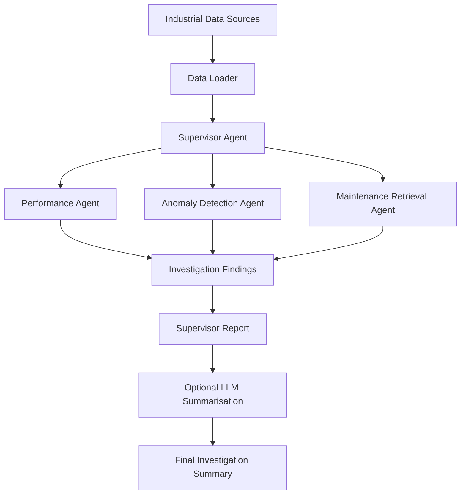

# Multi-Agent Industrial Maintenance System

A Python-based multi-agent prototype for industrial maintenance analysis using synthetic wind turbine data. The system combines production performance analysis, statistical anomaly detection, maintenance record retrieval and optional LLM-powered reporting into a coordinated investigation workflow.

## Project Overview

Industrial maintenance teams often need to examine multiple sources of information, including production records, sensor readings and historical maintenance reports.

This project explores how a multi-agent AI system can help bring these information sources together and generate structured investigation summaries.

The prototype uses four cooperating components:

- **Performance Agent:** Compares actual and expected energy production to identify production deviations.
- **Anomaly Detection Agent:** Applies statistical Z-score analysis to flag unusual sensor observations.
- **Maintenance Retrieval Agent:** Retrieves potentially relevant historical maintenance records using text-based retrieval.
- **Supervisor Agent:** Coordinates the specialist agents and combines their findings into a structured investigation report.

## System Architecture



## Technologies

- Python
- Pandas
- NumPy
- Scikit-learn
- Statistical anomaly detection
- TF-IDF-based retrieval
- LLM API integration
- Streamlit
- CSV-based synthetic datasets

## Project Structure

```text
multi_agent_industrial_maintenance/
│
├── data/
│   ├── maintenance_records.csv
│   ├── production.csv
│   └── sensor_readings.csv
│
├── examples/
│   └── sample_investigation_WT03.txt
│
├── src/
│   └── maintenance_ai/
│       ├── __init__.py
│       ├── agents.py
│       ├── data_loader.py
│       ├── llm.py
│       ├── retrieval.py
│       └── supervisor.py
│
├── tests/
│   └── test_system.py
│
├── .env.example
├── app.py
├── README.md
├── requirements.txt
└── run.py
```

## How It Works

### 1. Data Loading

The system loads synthetic industrial datasets containing:

- Turbine production records
- Sensor measurements
- Historical maintenance records

### 2. Performance Analysis

The Performance Agent compares actual and expected energy production to identify production gaps and calculate deviations.

### 3. Statistical Anomaly Detection

The Anomaly Detection Agent uses statistical Z-score analysis to identify unusual sensor observations that may require further investigation.

### 4. Maintenance Information Retrieval

The Maintenance Retrieval Agent searches historical maintenance records and retrieves potentially relevant information based on the investigation context.

### 5. Multi-Agent Coordination

The Supervisor Agent coordinates the specialist agents, combines their findings and generates a structured maintenance investigation summary.

### 6. LLM-Powered Reporting

An optional LLM integration can be used to produce more natural-language summaries of the collected findings.

## Installation

Clone the repository:

```bash
git clone YOUR_GITHUB_REPOSITORY_URL
cd multi-agent-industrial-maintenance
```

Create a virtual environment:

```bash
python -m venv .venv
```

Activate it.

Windows:

```bash
.venv\Scripts\activate
```

macOS/Linux:

```bash
source .venv/bin/activate
```

Install dependencies:

```bash
pip install -r requirements.txt
```

## Run the Project

Run an investigation for a selected turbine:

```bash
python run.py --turbine WT-03
```

Launch the interactive Streamlit application:

```bash
streamlit run app.py
```

For optional LLM functionality, configure the required environment variables using `.env.example`. Never commit API keys or credentials to GitHub.

## Example Investigation

The following is an example generated using synthetic demonstration data.

**Investigation summary:**

- Actual production: 142,271.5 kWh
- Expected production: 155,179.8 kWh
- Production gap: 12,908.3 kWh
- Production below expected: 8.32%
- Sensor observations flagged: 6
- Potentially relevant maintenance records retrieved: 2

The system combines these findings into an investigation summary to support further analysis.

**Important:** Statistical anomaly flags do not confirm equipment faults. A production deviation does not establish its root cause. Maintenance decisions require qualified human review.

## Testing

Run the system tests with:

```bash
python -m pytest tests/
```

## Current Limitations

- Uses synthetic demonstration data rather than live industrial systems.
- Statistical anomaly detection is based on Z-score analysis.
- Maintenance retrieval uses TF-IDF-based text retrieval.
- LLM functionality is optional.
- The prototype has not been deployed in a production environment.
- No formal predictive accuracy or business-impact benchmark has been established.

## Future Improvements

- Integrate semantic embeddings and a vector database for improved maintenance document retrieval.
- Explore LangGraph for more advanced agent orchestration.
- Improve anomaly detection using machine learning methods.
- Add systematic evaluation of retrieval and generated responses.
- Introduce a more comprehensive investigation dashboard.
- Explore integration with real industrial data sources in a controlled environment.

## Project Status

**Status: Local prototype / Work in Progress**

This project was developed as a personal practice project using synthetic industrial data to explore multi-agent workflows for industrial maintenance analysis.

